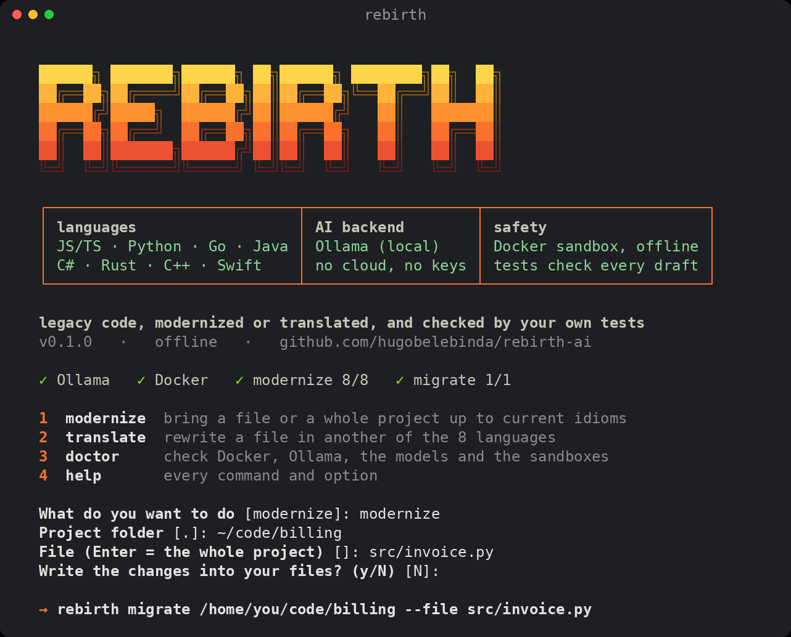

# Rebirth AI

**Modernize legacy code, or translate it to another language, and keep a change only when your own tests
pass.** Rebirth runs entirely on your machine: local models in [Ollama](https://ollama.com), your tests in a
locked-down Docker sandbox, no cloud and no API keys.



- **Modernize:** brings a file or a whole project up to current idioms in the same language.
- **Translate:** rewrites a file in another language. Any of the 8 languages to any other.
- **Checked by your tests:** each draft runs against your project's tests in a sandbox with no network,
  and is retried with the errors when it fails. A draft that fails the tests is never written.
- **8 languages:** JavaScript / TypeScript, Python, Go, Java, C#, Rust, C++, Swift.
- **Private:** nothing leaves your machine while it runs.
- **Your choice of model:** it ships models fine-tuned for these jobs, and also runs any other model you have in
  Ollama.

## Contents

- [How it works](#how-it-works)
- [Why Rebirth?](#why-rebirth)
- [Requirements](#requirements)
- [Install](#install)
- [Quick start](#quick-start)
- [Guide](#guide)
  - [Modernize one file](#modernize-one-file)
  - [Modernize a whole project](#modernize-a-whole-project)
  - [Translate to another language](#translate-to-another-language)
  - [Open a pull request](#open-a-pull-request)
  - [Give the model more context (code search)](#give-the-model-more-context-code-search)
  - [Read the results](#read-the-results)
- [Languages](#languages)
- [Configuration](#configuration)
- [Use another model](#use-another-model)
- [What to expect](#what-to-expect)
- [Project status](#project-status)
- [Privacy and security](#privacy-and-security)
- [Troubleshooting](#troubleshooting)
- [How it was built](#how-it-was-built)
- [Development](#development)
- [Contributing](#contributing)
- [License](#license)

## How it works

For each file, Rebirth runs a loop:

1. **Find the tests.** It looks for the test that imports the file, or uses the whole test suite. You can name
   one with `--test`.
2. **Write a draft.** A local model rewrites the file:
   - for modernizing, a small 7B model trained for that language;
   - for translating, a 14B model trained to translate between the 8 languages.
3. **Test it.** Rebirth copies your project into a Docker container, writes the draft in, cuts the network and
   runs your tests.
4. **Retry on failure.** It classifies the error (syntax, types, a missing package, a failing assertion…) and
   asks the model for a new draft, up to 5 times.
5. **Keep or drop.** A draft is kept only if the tests pass and the code actually changed. Otherwise your file
   stays as it was.

When the 7B model passes the tests without changing anything, Rebirth asks a 14B model once more
([fallback](#modernize-one-file)).

## Why Rebirth?

A model only writes a draft. Rebirth decides whether that draft is safe to keep, and does the work around it:
- it finds the tests;
- it orders the files by their imports;
- it runs the tests on every draft in a sandbox, and retries with the errors;
- it writes only what passes.

**Why not just run a bigger model?** You can, inside Rebirth: it runs any model you have in Ollama (see
[Use another model](#use-another-model)). A bigger model writes better drafts; Rebirth is what checks them.
Rebirth's own models exist so that one 8–16 GB GPU is enough. Its 14B translation model scores about like a
30B model that doesn't fit in 16 GB.

**Why not an AI coding agent (Claude Code, Codex, Cursor…)?** For a large refactor that needs judgment across
many files, a frontier agent is more capable. Rebirth is built for a different case:
- **Your code can't leave the machine.** Banks, hospitals, defense, government and code under NDA often can't
  be sent to a cloud API. Rebirth runs offline.
- **The test check is enforced, not requested.** An agent may run your tests. Rebirth cannot write a change that
  fails them.
- **Model-written code runs in a sandbox** with no network and no access to the rest of your machine, not with
  your user's permissions.
- **No per-token cost.** A thousand files on your own GPU cost electricity.
- **Every run is logged** with the model that wrote each draft, and a model update can be rolled back.

For framework migrations, redesigns and changes that span many files at once, use an agent or a person.

## Requirements

| | Minimum | Notes |
|---|---|---|
| OS | Linux x86-64 | Tested on Ubuntu 24.04. macOS and Windows (WSL2) are untested. |
| Python | 3.11+ with `venv` | `sudo apt install python3 python3-venv` |
| Docker | Engine 24+ | Your user must be in the `docker` group. |
| Ollama | 0.30+ | Must be running (`ollama list` works). |
| GPU | 16 GB for both models, 8 GB for modernizing only | Tested on AMD (RX 7800 XT). NVIDIA works through Ollama but is untested ([Project status](#project-status)). Without a GPU, Ollama runs on the CPU, which is very slow. |
| Disk | ~35 GB free | Models ~17 GB, sandbox images ~11 GB, Python environment ~3 GB. |
| Internet | for the install | Afterwards Rebirth works offline. The sandbox still downloads the dependencies your project declares (npm, pip, Maven, NuGet, Go, Cargo, SwiftPM) before testing. |

## Install

```bash
git clone https://github.com/hugobelebinda/rebirth-ai
cd rebirth-ai
bash scripts/bootstrap.sh                      # both models
# or: bash scripts/bootstrap.sh --pack modernize   (8 GB GPU: modernizing only)
```

The script never uses `sudo`. It:

1. checks for git, Python, Docker and Ollama;
2. creates `.venv` and installs Rebirth;
3. builds the 8 sandbox images;
4. downloads the models from Hugging Face, checks each file's sha256, and registers them in Ollama;
5. runs `rebirth doctor`.

Re-running it is safe, and an interrupted download resumes. Then put `rebirth` on your path:

```bash
source .venv/bin/activate        # or: ln -s "$PWD/.venv/bin/rebirth" ~/.local/bin/rebirth
rebirth doctor                   # ends with "all checks passed"
```

Offline install from a USB stick or a mirror: [docs/INSTALL.md](docs/INSTALL.md).

### The two models

| Pack | Used for | Download | GPU memory |
|---|---|---:|---:|
| **modernize** | Modernizing in the same language. One 7B base model (Qwen2.5-Coder 7B) and 8 small language adapters. | ~4.8 GB | 8 GB |
| **migrate** | Translating between languages (`--to`). One 14B model (Qwen2.5-Coder 14B, fine-tuned). | ~12.1 GB | 16 GB |

## Quick start

Run `rebirth` with no arguments for the start screen. It checks your setup, asks what you want to do, then shows
and runs the matching command:

```text
What do you want to do [modernize]: modernize
Project folder [.]: ~/code/billing
File (Enter = the whole project) []: src/invoice.py
Write the changes into your files? (y/N) [N]:

→ rebirth migrate /home/you/code/billing --file src/invoice.py
```

Or use the commands directly:

```bash
rebirth migrate ~/code/billing --file src/invoice.py             # modernize one file, show the result
rebirth migrate-repo ~/code/billing --write                      # modernize every file, keep what passes
rebirth migrate ~/code/billing --file src/invoice.py --to go     # translate a file to Go
```

`rebirth --help` lists every command, and `rebirth <command> --help` lists its options.

## Guide

### Modernize one file

```bash
rebirth migrate <project> --file <path in the project>
```

- **Nothing in your project changes** unless you add `--write`. Without it, Rebirth shows the result and the
  run is kept in the report. `--out <path>` saves the new version somewhere else.
- **Tests:** by default, the test that imports the file, else the whole suite. Use `--test <path>` to pick one.
- **What to change:** `--objective "<text>"` steers the model, for example
  `--objective "Convert the callbacks to async/await"`. The default is "modernize the idioms without changing
  the public API; keep comments and docstrings".
- **Retries:** `--max-iterations <n>` (default 5).
- **Fallback:** when the 7B model passes the tests without changing anything, Rebirth tries once more with a
  14B model:
  - it uses the plain Qwen2.5-Coder 14B if you have it (`ollama pull qwen2.5-coder:14b-instruct-q6_K`), else
    the translation model;
  - if the 14B finds no passing change either, your file stays as it was;
  - `--no-fallback` turns it off.
- **Comments are kept:** a draft that deletes many of the file's comments goes back to the model, even if it
  passes the tests.

### Modernize a whole project

```bash
rebirth migrate-repo <project> --dry-run    # only the plan: which files, in what order, which tests
rebirth migrate-repo <project>              # run everything and report; your files don't change
rebirth migrate-repo <project> --write      # also write the changes that passed
```

- **Which files:** every source file under `src/` if the project has one, else the whole project. Rebirth skips
  tests, vendored code (`node_modules`, `vendor`, …), build outputs and files over 200 KB. Change the folders with
  `--under lib,app`, or pick files with `--file` (repeatable).
- **Order:** files are done in dependency order, so a file is migrated after the files it imports.
- **Report:** a JSON report goes to `data/reports/migrate_repo.json` in the Rebirth folder (`--report` changes
  it). `rebirth report <file>` prints it, with secrets redacted.
- **Time:** expect 20–60 s per file with the 7B model, plus the fallback when it runs. See
  [What to expect](#what-to-expect).

### Translate to another language

```bash
rebirth migrate <project> --file src/parser.py --to go
```

- **Output:** the translation is written as a **new file** under `<project>/rebirth_out/go/`, mirroring the
  source tree. The source file is never modified. `--out-dir` puts it elsewhere.
- **Checks:** by default the translation must compile. To check it against real tests, point Rebirth at a
  project in the target language:

  ```bash
  rebirth migrate ./py-app --file src/parser.py --to go \
    --target-project ./go-app --target-file parser/parser.go --target-test parser/parser_test.go
  ```

- **Languages:** `python`, `javascript`, `typescript`, `go`, `java`, `csharp`, `rust`, `cpp`, `swift`. Short
  names also work: `py`, `js`, `ts`, `golang`, `c#`, `cs`, `rs`, `c++`.
- **Standard library only:** third-party packages are not mapped to equivalents in the target language.

### Open a pull request

```bash
gh auth login                                  # once; Rebirth uses your own gh login
rebirth migrate-repo <project> --open-pr       # add --draft for a draft PR
```

Rebirth creates a new branch (`rebirth/migrate`, or `--pr-branch`) in the project's own git repository. It
commits only the files whose tests passed, pushes the branch and opens the PR. The PR description lists:
- the files that changed;
- the files left unchanged;
- the files that need review, with an excerpt of their test log.

Review the PR like any other before merging it. It refuses a branch that already exists and never commits
secret-looking files.

### Give the model more context (code search)

```bash
rebirth index <project>
```

This builds a code-search index of the project. Later runs on **that project** show the model the code a file
uses, such as the functions and types it imports from elsewhere. It's optional, and most useful when files
depend on each other. One project is indexed at a time: indexing another replaces it.

### Read the results

| Result | Meaning | Your file |
|---|---|---|
| `success` | The code changed and the tests pass. | Written with `--write`, else shown |
| `unchanged` | The tests pass and the model found nothing to change. | Left as it was |
| `human_review` | No passing draft after all tries. The last draft and the test log are kept (the run prints where). | Left as it was |

`rebirth migrate` exits 0 for `success` or `unchanged` and 1 for `human_review`. `rebirth migrate-repo` exits 1
if any file needs review. Both exit 2 for bad input or a missing requirement (Docker, Ollama, a sandbox image),
with a one-line error.

**Passing tests are evidence, not proof.** Rebirth keeps a draft because your tests pass, so behaviour your tests
don't cover can still change. Read every diff before you merge it.

## Languages

| Language | Files | Tests run with | Sandbox toolchain |
|---|---|---|---|
| JavaScript / TypeScript | `.js` `.mjs` `.cjs` `.ts` `.tsx` … | `npm test`, or `node --test <file>` | Node 22 |
| Python | `.py` | `python -m pytest` | Python 3.12 |
| Go | `.go` | `go test` | Go 1.27 |
| Java | `.java` | `mvn test` | JDK 21, Maven 3.9 |
| C# | `.cs` | `dotnet test` | .NET 10 SDK, with .NET 8 |
| Rust | `.rs` | `cargo test` | Rust 1.99 |
| C++ | `.cpp` `.cc` `.h` `.hpp` … | your CMake build and tests | GCC 14, CMake |
| Swift | `.swift` | `swift test` | Swift 6.4 |

Rebirth picks the language from the project's files (`package.json`, `pyproject.toml`, `go.mod`, `pom.xml`,
`*.csproj`, `Cargo.toml`, `CMakeLists.txt`, `Package.swift`). `--lang <id>` overrides it: `js_ts`, `python`,
`go`, `java`, `csharp`, `rust`, `cpp`, `swift`.

## Configuration

Everything has a default. These environment variables change it:

| Variable | Default | What it does |
|---|---|---|
| `OLLAMA_HOST` | `http://127.0.0.1:11434` | Where Ollama runs. |
| `OLLAMA_MODEL` | `qwen2.5-coder:14b-instruct-q6_K` | The model `--backend ollama` uses, and the fallback's first choice. |
| `REBIRTH_FALLBACK` | `1` | `0` turns the 14B fallback off. |
| `REBIRTH_FALLBACK_MODEL` | plain 14B, else the translation model | The Ollama model the fallback uses. |
| `REBIRTH_FALLBACK_TRIES` | `2` | Tries the fallback model gets. |
| `REBIRTH_XLANG_MODEL` | `rebirth-xlang:14b` | The Ollama model `--to` uses. |
| `REBIRTH_MAX_ITERATIONS` | `5` | Tries per file. |
| `REBIRTH_KEEP_COMMENTS` | `1` | `0` lets drafts drop comments. |
| `REBIRTH_SANDBOX_TIMEOUT_SEC` | 120–300 by language | Time limit for one test run. |
| `REBIRTH_SANDBOX_MEMORY` | `4g` | Memory limit for the sandbox. |
| `REBIRTH_SANDBOX_PIDS` | `1024` | Process limit for the sandbox. |
| `REBIRTH_MAX_FILE_BYTES` | `204800` | Larger files are skipped. |

All variables, including the ones for maintainers: [`.env.example`](.env.example).

## Use another model

Rebirth works with any model you can run in Ollama. A run uses up to three models:

| Step | Default | To use another model |
|---|---|---|
| Modernize: the first drafts | `rebirth-<lang>:7b` (fine-tuned) | `--backend ollama`, with `OLLAMA_MODEL=<model>` |
| Fallback: after an unchanged result | the plain Qwen2.5-Coder 14B, else the translation model | `REBIRTH_FALLBACK_MODEL=<model>` |
| Translate (`--to`) | `rebirth-xlang:14b` (fine-tuned) | `REBIRTH_XLANG_MODEL=<model>` |

For example, on a 32 GB GPU (RTX 5090), keep the fine-tuned 7B models for the first drafts and give the rest to
a larger model:

```bash
ollama pull qwen3-coder:30b
export REBIRTH_FALLBACK_MODEL=qwen3-coder:30b REBIRTH_XLANG_MODEL=qwen3-coder:30b
rebirth migrate-repo ~/code/billing
```

**Another model does not get Rebirth's fine-tuning.** The adapters were trained on the weights of
Qwen2.5-Coder 7B and 14B and only work with them. Another model writes its drafts with its own skills and
Rebirth's prompts. It still gets everything else: the tests, the sandbox, the retries, the file order and the
pull request.

What this means in practice:
- **Translation:** on the same 420 program translations, all run in full precision (bf16) on the same GPU:

  | Model | Verified translations |
  |---|---:|
  | Qwen3-Coder-30B-A3B, no fine-tuning | 282 |
  | Rebirth's fine-tuned 14B | 274 |
  | Plain Qwen2.5-Coder 14B | 215 |

  So a 30B model translates about as well as Rebirth's 14B, but needs about 20 GB of GPU memory.
- **Modernize:** other models were not measured. The fine-tuned 7B matches the human change 2.5 times as often
  as its base model (107 against 42), and it is fast, so keep it for the first drafts.
- **Reasoning models** (Qwen3, DeepSeek-R1…) work: their reasoning is dropped before the code is read. They are
  slower.
- **A typo in `REBIRTH_XLANG_MODEL`** is reported, and the plain 14B is used instead.
- **To fine-tune a larger model the same way,** start from the training code and the data scripts in
  [`training/`](training/) and [docs/DATASET.md](docs/DATASET.md).

## What to expect

**Measured quality.** All models were measured locally, served exactly as installed:

| Task | Test | Base model | Rebirth |
|---|---|---:|---:|
| Modernize | 749 held-out real commits in 8 languages: output matches the human change | 42 | **107** |
| Translate | 931 whole programs over all 56 language pairs, judged by 10 tests each | 551 (59 %) | **667 (72 %)** |
| Translate | 2,229 HumanEval functions over all 56 pairs | 91.1 % | **92.6 %** |

On 14 files from 10 small public libraries (JavaScript, Python, Go), with their own tests:
- 8 were modernized with the tests passing;
- 6 were left unchanged;
- none was broken.

Details: [docs/phases/PHASE_19_LAUNCH.md](docs/phases/PHASE_19_LAUNCH.md).

**Speed** on a 16 GB GPU (RX 7800 XT):
- 20–60 s per file with the 7B model, more when it retries;
- the 14B fallback adds about 30–50 s when it finds a change, and up to ~2 min when it doesn't;
- the 14 files above took 21 min in all, so a 100-file project takes about two to three hours.

**Limits:**
- Rebirth works one file at a time. It doesn't redesign a whole codebase or split files.
- Weak tests let wrong code through. A file without tests can't be checked.
- Projects whose tests need network access (live APIs, databases over the network) fail in the sandbox.
- Translations only use the target language's standard library.
- The models were trained on files of up to a few hundred lines. Very long files are slower and less reliable.

## Project status

1.0 is the first public release, built and maintained by one developer.

- **Tested:**
  - Ubuntu 24.04 with an AMD RX 7800 XT (16 GB) and Ollama 0.30;
  - all 8 languages on their sample projects;
  - 333 automated tests, run by CI on every change.
- **Not tested yet:** NVIDIA GPUs, 8 GB GPUs, macOS and Windows (WSL2). Ollama supports them, so Rebirth should
  work there. A report from one of these setups is the most useful contribution right now
  ([Contributing](#contributing)).
- **Measured on real code:** 14 files from 10 small libraries, in JavaScript, Python and Go. The other 5
  languages have been run on sample projects only.

## Privacy and security

- **Nothing leaves your machine while Rebirth runs.** It sends no telemetry.
- **Model-written code never runs with network access.** Your project is copied into the container (never
  mounted), runs as a non-root user with no Linux capabilities, and has memory, process and time limits.
- **Your project's dependencies are installed only when it declares them.** A package that only the model asks
  for is refused, since invented names can be typo-squatted.
- **Network is used only:**
  - to download the models at install;
  - for the sandbox's setup step, which downloads your declared dependencies before the draft is written in;
  - for `--open-pr`.

Full details and how to report a vulnerability: [docs/SECURITY.md](docs/SECURITY.md).

## Troubleshooting

| Symptom | Fix |
|---|---|
| `Docker is not reachable` | Start Docker. Run `sudo usermod -aG docker $USER`, then log out and back in. |
| `Ollama is not reachable` | `ollama serve`, or `sudo systemctl start ollama`. |
| `Sandbox image … is missing` | `bash scripts/bootstrap.sh` builds all 8, or `docker build -t rebirth-ai/<lang>-sandbox:latest docker/<lang>_sandbox`. |
| A model is missing | `rebirth install --pack modernize` or `--pack migrate`. |
| `No source files found` | Point `--under` at your source folders, or name files with `--file`. |
| Every file ends in `human_review` | Run your tests yourself first: they must pass on the original code. Check that they don't need network access. |
| Very slow | The 14B model doesn't fit your GPU and runs partly on the CPU (`ollama ps` shows the split). Use `--no-fallback`, or a 16 GB GPU. |

More: [docs/INSTALL.md](docs/INSTALL.md#troubleshooting). To uninstall:
[docs/INSTALL.md](docs/INSTALL.md#uninstall).

## How it was built

Rebirth started from one rule: **don't trust the model, trust the tests.** The model proposes a change, and the
project's own tests decide whether it stays. The rest of the work was making that run offline on one consumer
GPU.

1. **Data.** 24,640 real before/after commits in the 8 languages, mined from permissively licensed repositories
   (BigCode's CommitPackFT and CommitPack). They were filtered by size, by Tree-sitter parsing and by commit
   quality.
2. **Modernize models.** One LoRA adapter per language on Qwen2.5-Coder 7B, trained in 4-bit (QLoRA) on an AMD
   RX 7800 XT. On 749 held-out commits they match the human change 107 times, against 42 for the base model.
3. **Translation data checked by tests.**
   - A 14B model translated CodeContests programs into the other languages.
   - Only the translations that pass the problem's own tests were kept: 30,211 verified pairs.
4. **Translation model.**
   - A LoRA on Qwen2.5-Coder 14B, trained in 4 h 38 min on one cloud GPU, then merged into the weights and
     quantized once.
   - Verified program translations went from 551 to 667 of 931.
   - Merging made generation 24 % faster.
5. **The agent.**
   - A LangGraph loop: draft, test in the sandbox, classify the error, retry.
   - Files are done in dependency order, with a 14B fallback.
6. **Around it:**
   - experiment tracking and a model registry (MLflow), and versioned data (DVC);
   - quality gates before a model is served, and rollback;
   - drift monitoring and CI.

Two decisions the measurements made:
- **The smaller model ships for modernizing.** A 14B with the same kind of adapters only tied the 7B, per 100
  commits (Go: 15 against 14; Python: 19 against 20). So the faster 7B is the one installed.
- **No second cloud round.** A 30B model was the candidate teacher for a second round of translation data.
  On its own it scored about the same as the fine-tuned 14B (282 against 274), so no more cloud spend went into
  that round.

Every measurement is in [docs/phases/](docs/phases/).

## Development

```bash
python3 -m venv .venv && source .venv/bin/activate
pip install -e ".[dev]"
pytest -q            # no GPU, Docker or models needed; Docker tests are skipped without Docker
ruff check .
```

CI runs the same lint and tests on every push. The models are trained and gated locally on a GPU:
- [`docs/PRODUCTION_ROADMAP.md`](docs/PRODUCTION_ROADMAP.md): the phases, from the MVP to v1.0;
- [`docs/DATASET.md`](docs/DATASET.md): the training data and where it comes from;
- [`docs/research/ADR-001_UNIFIED_VS_SPECIALISTS.md`](docs/research/ADR-001_UNIFIED_VS_SPECIALISTS.md): why
  there are two models;
- [`docs/phases/`](docs/phases/): one report per phase, with every measurement.

Maintainer commands (training, evaluation, model registry, serving, monitoring) are listed under their own
headings in `rebirth --help`.

## Contributing

Contributions are welcome: see [CONTRIBUTING.md](CONTRIBUTING.md). The most useful right now:
- **Hardware reports:** run Rebirth on a setup it hasn't been tested on (NVIDIA, an 8 GB GPU, macOS, WSL2)
  and [open a hardware report](https://github.com/hugobelebinda/rebirth-ai/issues/new?template=hardware_report.md);
- **Real projects** added to the benchmark, especially in Java, C#, Rust, C++ and Swift;
- **A new language;**
- **Third-party packages** mapped between languages for `--to`.

Report security issues privately: [docs/SECURITY.md](docs/SECURITY.md).

## License

- **Rebirth's code:** MIT ([LICENSE](LICENSE)).
- **The models:** Apache-2.0, like their base model Qwen2.5-Coder.
- **Training data:** permissively licensed repositories from BigCode's CommitPackFT / CommitPack, and DeepMind
  CodeContests (CC BY 4.0). Credits are in [docs/DATASET.md](docs/DATASET.md).
